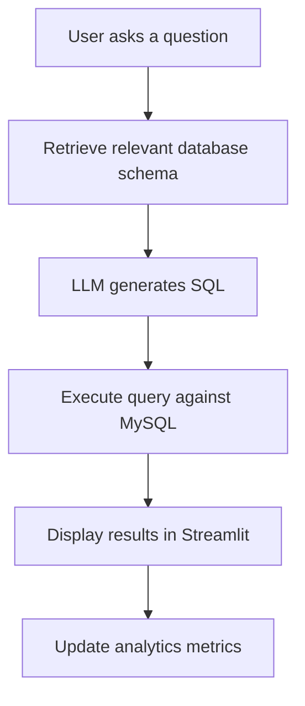

# 🤖 Text-to-SQL RAG Chatbot

**Ask questions in plain English. Get SQL queries and database results instantly.**

An AI-powered chatbot that converts natural-language questions into SQL queries, executes them against a MySQL database, and displays results in an interactive Streamlit interface.

  <a href="https://text-to-sql-rag-chatbot-sb-as.streamlit.app/">
    <strong>🚀 Try the Live Demo</strong>
  </a>
  &nbsp; | &nbsp;
  <a href="https://github.com/suryanshbaranwal/text-to-sql-rag-chatbot">
    <strong>💻 View Source Code</strong>
  </a>

  
  
  
  
  

## ✨ Features

- 💬 **Natural Language to SQL:** Ask questions about your database in plain English.
- 🧠 **RAG-Based Schema Retrieval:** Retrieve relevant database schema information to help generate context-aware SQL.
- ⚡ **LLM-Powered SQL Generation:** Generate SQL queries using the Groq API.
- 🗄️ **MySQL Integration:** Connect to local or cloud-hosted MySQL databases.
- 📊 **Interactive Results:** View query results in structured tables.
- 🔄 **Error Handling:** Retry or repair certain SQL errors.
- 📈 **Analytics Dashboard:** Track query counts, success rate, failures, and response time.
- ☁️ **Cloud Deployment:** Access the application through Streamlit Community Cloud.

## 🔗 Live Demo

**[Open Text-to-SQL RAG Chatbot](https://text-to-sql-rag-chatbot-sb-as.streamlit.app/)**

The application has been tested with a MySQL database containing these tables:

`customers` · `order_items` · `orders` · `payments` · `products`

To use the application, provide your own MySQL connection details and Groq API key in the sidebar.

## 🛠️ Tech Stack

| Component | Technology | Why Used |
|---|---|---|
| Programming Language | Python | AI and data processing |
| Web Interface | Streamlit | Interactive chatbot UI |
| LLM Provider | Groq API | Fast AI inference |
| LLM Framework | LangChain | LLM and database integration |
| Database | MySQL | Store structured data |
| Database Connectivity | SQLAlchemy, PyMySQL | Connect Python with MySQL |
| Embeddings | Hugging Face Sentence Transformers | Convert text into vectors |
| Vector Search | FAISS | Retrieve relevant schema |
| Data Processing | Pandas, NumPy | Process query results |

## 🏗️ How It Works

1. The user enters a question in natural language.
2. The application retrieves relevant database schema information.
3. The LLM generates an SQL query using the available context.
4. The application executes the query against the connected MySQL database.
5. Results are displayed in a table, and query metrics are updated.

## 💡 Example Questions

Try asking:

- `Show the top 10 products by total revenue.`
- `Which are the top 5 customers by total spending?`
- `Show monthly sales for the last 12 months.`
- `How many orders are there in the database?`

The actual results depend on the connected database and its data.

## 🗺️ Future Improvements

- Stronger SQL validation and read-only query enforcement.
- Improved query accuracy and schema retrieval.
- Query history and downloadable results.
- More robust automated testing.
- Enhanced visualizations and analytics.

## 👥 Contributors

- Suryansh Baranwal
- Abhishek Singh

---

**Built with Python, Streamlit, LangChain, Groq, FAISS, and MySQL.**